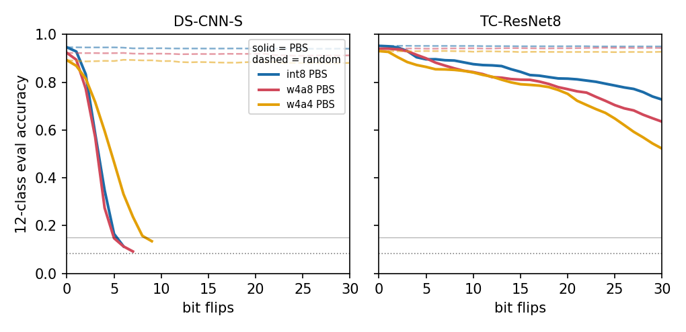

# Bit-flip attacks on microcontroller-scale keyword spotting: how many flips, and does 4-bit quantisation change the count?

A trained neural network is stored in memory as a list of integers. A fault-injection attacker who can flip
individual bits of those integers (the Rowhammer-style threat) does not need many flips to ruin a large image
classifier: the Bit-Flip Attack paper showed ResNet-18 on ImageNet collapsing to chance with 13 flips out of 93
million bits. I wanted the equivalent number for the kind of model that actually runs on a microcontroller doing
keyword spotting: a few hundred thousand weight bits, not ninety million. Two questions:

1. How many targeted bit flips does it take to break a small keyword-spotting model, driving its 12-class
   accuracy down to 15% (chance is 1/12 ~ 8.3%)?
2. Does quantising the weights from 8 bits to 4 bits change that count, and in which direction?

Everything below is measured on two models, DS-CNN-S and TC-ResNet8, each at three quantisations, three
seeds, against two attackers (progressive bit search and a random-flip baseline). The models, the integer
simulator and the MFCC front ends are reused unchanged from my earlier keyword-spotting quantisation project, so
the attack here runs on exactly the integer weights those models ship with.

## Summary

- DS-CNN-S (176k weight bits at int8) breaks in a handful of targeted flips: a mean of 5.3 at int8, 5.7 at w4a8 and
  8.0 at w4a4. TC-ResNet8 (516k weight bits at int8) never reached the 15% target within the 30-flip cap on any of
  its 18 runs. Its most successful run (w4a4, one seed) reached 20.4% accuracy at 30 flips.
- Lower precision did not reduce the flip count. For DS-CNN-S the mean rises as precision drops. The 4-bit models
  also start from a lower baseline accuracy (w4a4 ~0.893, int8 ~0.947), so they have less distance to fall to the
  fixed 15% line.
- With 3 seeds the bit-width effect is small and noisy. The DS-CNN-S ranges overlap (int8 [5,6], w4a8 [5,7], w4a4
  [6,9]), and TC-ResNet8 gives no flip count to compare.
- Random flips broke no model in any of the 18 baseline runs. Accuracy stays within a point or two of baseline after
  30 flips.
- This is not the first bit-flip study on audio: DeepHammer (USENIX Security 2020) and NeuroPots (USENIX Security
  2023) both ran bit-flip attacks on Google Speech Commands. This study looks at microcontroller-scale keyword models
  and compares int8 with 4-bit weights on them.

## Contents

[Setup](#setup) · [The attack](#the-attack) · [Results](#results) · [Flips per stored bit](#flips-per-stored-bit)
· [Related work](#related-work) · [Limits](#limits-of-these-numbers) · [Reproduce](#reproduce) ·
[Credits](#credits) · [Licence](#licence)

## Setup

Models. Two quantised keyword-spotting networks, one per architecture family:

- DS-CNN-S: the small depthwise-separable CNN from the Hello-Edge / MLPerf-Tiny keyword line (10-MFCC front
  end), 176,128 weight bits at int8.
- TC-ResNet8: a temporal-convolution residual network (40-MFCC front end), 516,096 weight bits at int8.

I had built five models in the earlier project (DS-CNN-S/M/L, TC-ResNet8, TC-ResNet14-1.5). I dropped DS-CNN-M,
DS-CNN-L and TC-ResNet14 here purely for compute, because this ran on a shared laptop, and kept one model per
family at three bit-widths and three seeds. The dropped blobs are still in `assets/models/` if someone wants to
extend the sweep.

The three quantisations. All weights are stored as signed integers; a flip toggles one bit of a weight's
*b*-bit two's-complement field (b = 8 or 4) and the result stays inside that field.

| name | weight bits | activation bits | role |
|---|---|---|---|
| int8 | 8 | 8 | the usual 8-bit integer model (the reference) |
| w4a8 | 4 | 8 | the clean controlled comparison: only the *weights* drop to 4 bits, activations stay at 8 |
| w4a4 | 4 | 4 | fully 4-bit: both weights and activations at 4 bits |

The int8 -> w4a8 pair isolates the weight bit-width (activations held at 8). w4a4 is the aggressive all-4-bit
setting. A 4-bit model stores half the weight bits of its int8 sibling (DS-CNN-S 88,064; TC-ResNet8 258,048).

Data and metric. The official Speech Commands v0.02 test set, indexed into the 12 classes (silence, unknown,
and the ten words). From it I fixed, before any attack, an index-disjoint split: a 1,200-clip attack pool
(progressive bit search draws its 64-clip attack batch from here) and a separate 1,500-clip evaluation set (all
reported accuracies and every accuracy-vs-flips curve come from this). Silence and unknown are kept in the 12-class
metric. "Broken" is pre-declared as evaluation accuracy at or below 15% (chance = 8.3%); the cap is 30
flips; seeds are 0, 1, 2.

## The attack

Two attackers, both deciding accept/reject on the exact integer simulator (`qmodel.run_int`), never on a float
approximation:

- PBS (progressive bit search), after Rakin et al. (ICCV 2019): each iteration, a gradient taken on a
  differentiable surrogate of the integer network *ranks* candidate weight bits; the top candidate of every weight
  layer is then evaluated with the exact integer simulator on the attack batch, and the single flip that raises
  cross-entropy the most is committed. Gradients only rank; every kept flip is judged by the integer model.
- random: flip a uniformly random bit of a uniformly random weight each iteration. The baseline.

Accuracy after each flip is measured on the held-out 1,500-clip evaluation set. The raw per-flip curves are in
`results/raw/curve_*.csv`; those curves are the ground truth, and `scripts/verify.py` recomputes every headline
number below straight from them.

## Results

Generated by `scripts/03_tables_figs.py` into `results/tables/flips_summary.md` (copied verbatim):

<!-- begin:flips_summary -->
| model | variant | base acc | PBS flips [min,max] (reached) | PBS flips/Mbit | random flips (reached) | random final acc |
|---|---|---|---|---|---|---|
| DS-CNN-S | int8 (8-bit W) | 0.947 | 5.3 [5,6] (3/3) | 30.281 | not reached (0/3) | 0.941 |
| DS-CNN-S | w4a8 (4-bit W) | 0.923 | 5.7 [5,7] (3/3) | 64.347 | not reached (0/3) | 0.913 |
| DS-CNN-S | w4a4 (4-bit W) | 0.893 | 8.0 [6,9] (3/3) | 90.843 | not reached (0/3) | 0.881 |
| TC-ResNet8 | int8 (8-bit W) | 0.953 | not reached (0/3) | - | not reached (0/3) | 0.950 |
| TC-ResNet8 | w4a8 (4-bit W) | 0.941 | not reached (0/3) | - | not reached (0/3) | 0.944 |
| TC-ResNet8 | w4a4 (4-bit W) | 0.931 | not reached (0/3) | - | not reached (0/3) | 0.928 |
<!-- end:flips_summary -->

`[min,max]` is the spread over the seeds that reached the target; `(reached)` counts how many of the 3 seeds hit
15% within 30 flips; `flips/Mbit` is mean flips per million stored weight bits (see below).



Left panel (DS-CNN-S): the solid PBS curves drop sharply and cross the 15% line within 5–9 flips; the dashed
random curves barely move. Right panel (TC-ResNet8): the PBS curves slope down but are still far above 15% at the
30-flip cap, and random is almost flat.

How I read it:

- Architecture had the largest effect. DS-CNN-S collapses in a handful of targeted flips;
  TC-ResNet8, roughly 3x larger in weight bits and with residual structure, resists the full 30-flip budget on
  every run. At 30 flips the mean TC-ResNet8 PBS accuracy was still 0.728 (int8), 0.635 (w4a8), 0.522 (w4a4), and
  the lowest any single TC-ResNet8 seed reached was 0.204 (w4a4), all above the 15% target. These TC-ResNet8
  numbers are censored at the 30-flip cap: I report them as "not reached" and did not raise the cap to force
  a crossing.
- Dropping precision did not help the attacker. For DS-CNN-S the mean flip count goes up, not down, as weights
  go from 8-bit to 4-bit (5.3 -> 5.7 -> 8.0). So on this evidence 4-bit quantisation is not a weakness to be
  exploited by fewer flips. w4a4 also starts lower (0.893 vs int8 0.947), so part of
  "needs more flips to reach a fixed 15%" is that it had less distance to fall.
- With 3 seeds, treat the bit-width ordering as weak. The DS-CNN-S ranges overlap (int8 and w4a8 especially),
  and TC-ResNet8 gives no crossing at all to compare. This is consistent with the original BFA paper, which found
  no clear relation between bit-width and flips needed (see below).
- Random flipping broke nothing (0/3 in all six cells) and left accuracy within ~2 points of baseline after 30
  flips, so the damage comes from the targeted search.

## Flips per stored bit

The raw flip count is the primary, operationally meaningful number: it is how many physical faults the attacker has
to land. But a 4-bit model stores half the weight bits of its int8 sibling, so a secondary way to look at it is
flips per stored weight bit (`flips/Mbit` above, = mean flips / total weight bits x 10^6, recomputed from the
raw curves; totals and the paired contrast are in `results/tables/paired_int8_vs_4bit.csv`):

- DS-CNN-S int8: 30.3 flips/Mbit (5.3 flips / 176,128 bits)
- DS-CNN-S w4a8: 64.3 flips/Mbit (5.7 flips / 88,064 bits)
- DS-CNN-S w4a4: 90.8 flips/Mbit (8.0 flips / 88,064 bits)

On a per-bit basis the 4-bit models look *more* robust: the attacker needs a larger fraction of the
(smaller) stored state. This agrees with the raw-count direction. I report both and lean on the raw count, since a Rowhammer-style attacker pays per flip, not per stored bit.

## Related work

Bit-flip attacks have already been run on audio:

- DeepHammer (Yao, Rakin, Fan, *USENIX Security 2020*) chains Rowhammer bit flips found by a progressive /
  flip-aware bit search, and explicitly evaluates on the Google Speech Commands dataset: "*the speech command
  dataset ... We test this dataset using VGG-11 and VGG-13 architectures.*"
- NeuroPots (Liu, Yin, Wen, Yang, Sha, *USENIX Security 2023*) is a defence against bit-flip attacks and
  evaluates them on Speech Commands too: "*Google Speech Command dataset is used to evaluate WideResNet28. The
  weights of all these DNNs are quantized to 8-bit.*"
- Bit-Flip Attack / Progressive Bit Search (Rakin, He, Fan, *ICCV 2019*) is the method I use for PBS. On the
  bit-width question they report: "*Under varying quantization configurations, there is no obvious relation between
  the quantization bit-width and the required number of bit-flips (i.e., robustness of DNN against BFA).*" My
  DS-CNN-S result (a weak, noisy, if-anything-upward trend with 3 seeds) is consistent with that.

This study applies PBS to microcontroller-scale keyword models (hundreds of thousands of weight bits) with a
controlled int8-vs-4-bit-weight comparison. At this scale, architecture mattered more than weight precision, and
lower precision did not reduce the flip count.

## Limits of these numbers

- Software simulation only. The flips are applied in a software integer model. Nothing ran on real hardware;
  there is no Rowhammer, no fault injection, no board. This measures *susceptibility of the weights* to flips, not
  whether a given attacker can land them.
- White-box attacker. PBS assumes full knowledge of the weights and the ability to compute gradients on a
  surrogate. A black-box attacker would need far more.
- Surrogate-gradient ranking. Candidate bits are *ranked* by a differentiable float surrogate of the integer
  network. Every accept/reject decision, though, is made on the exact integer simulator, so the ranking being
  approximate can only cost the attacker efficiency, not validity of a reported flip.
- Only 3 seeds, 2 models. Enough to see the architecture gap clearly; not enough to make strong claims about the
  bit-width ordering, which overlaps within this noise. DS-CNN-M/L and TC-ResNet14-1.5 were dropped for compute.
- Censored at 30 flips. The TC-ResNet8 cells never reached 15% within the cap. "Not reached (0/3)" means exactly
  that; I did not extend the budget to manufacture a crossing.
- Metric choices. Silence and unknown are kept in the 12-class accuracy (chance 1/12). The attack pool and
  evaluation set are index-disjoint but drawn from the same test set and share speakers, so they are not
  speaker-disjoint.

## Reproduce

Needs Python 3.13 and the pinned packages in `requirements.txt` (numpy, pandas, scipy, matplotlib, torch;
torchaudio is installed into `./.pylib` with `--no-deps` so it matches the installed torch). The model blobs are in
`assets/models/`; put the official Speech Commands v0.02 test set in `data/test_set/` (12 class folders). The heavy
steps run at background priority with threads capped at 2 so a shared laptop stays usable.

```
./run_all.sh
```

which runs, in order:

```
python3 -I tests/test_bitflip.py                      # the one-bit-flip primitive (4- and 8-bit fields)
python3 scripts/01_features.py                        # MFCC features + the fixed disjoint attack/eval split
python3 scripts/02_attack.py --models s,tc8 --variants int8,w4a8,w4a4 --seeds 3 --max-flips 30
python3 scripts/03_tables_figs.py                     # raw/summary.csv, the tables, and the figure
python3 scripts/verify.py                             # recompute every headline number from the raw curves
```

`scripts/02_attack.py` writes one `results/raw/curve_*.csv` per (model, variant, method, seed).
`scripts/03_tables_figs.py` aggregates every curve on disk into `results/raw/summary.csv`,
`results/tables/flips_summary.{csv,md}` and `results/tables/paired_int8_vs_4bit.csv`, and draws
`results/figures/accuracy_vs_flips.png`. `scripts/verify.py` reads only the raw curves (not the summary),
recomputes each run's baseline accuracy and the first flip that reaches the target, checks them against the tables,
and prints `OK` or exits non-zero. The numbers in this README come from those scripts.

## Credits

The keyword-spotting models, the integer simulator (`qmodel.run_int`), the blob loader and the MFCC front ends are
reused unchanged from my earlier keyword-spotting quantisation project, so the two studies are directly comparable.
The PBS method is from Rakin, He and Fan (ICCV 2019). The data is Pete Warden's Speech Commands v0.02. The related
work cited above is DeepHammer (Yao, Rakin, Fan, USENIX Security 2020) and NeuroPots (Liu, Yin, Wen, Yang, Sha,
USENIX Security 2023).

## Licence

MIT (see `LICENSE`).
